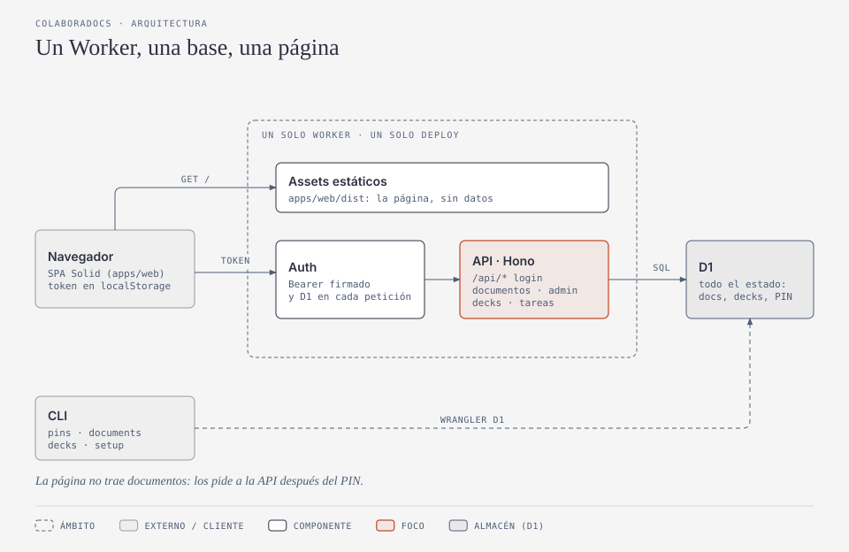
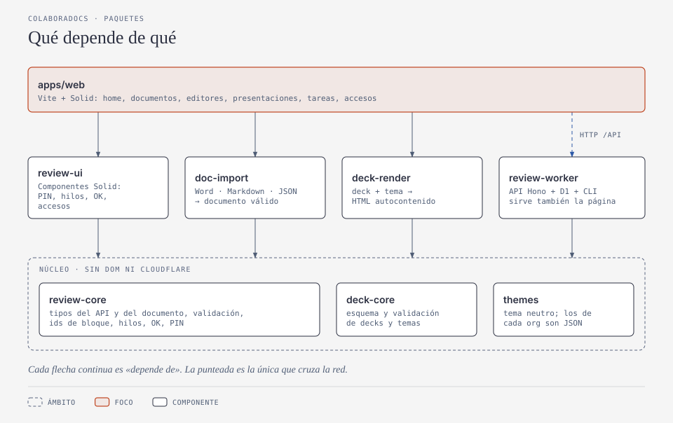
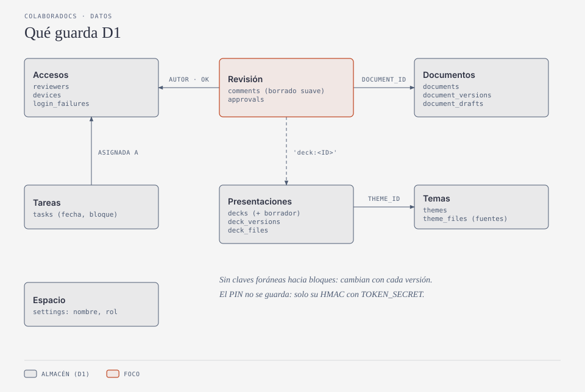
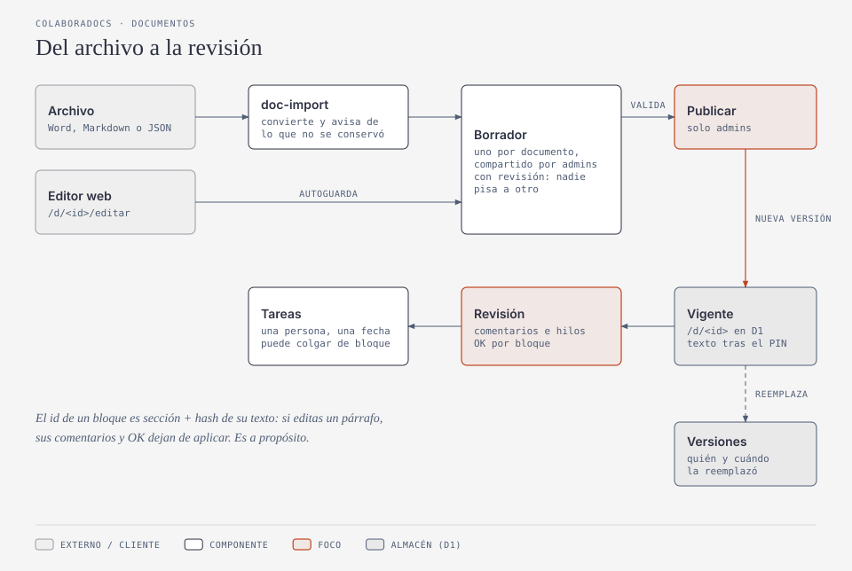
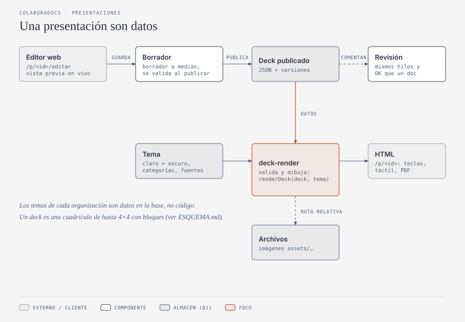
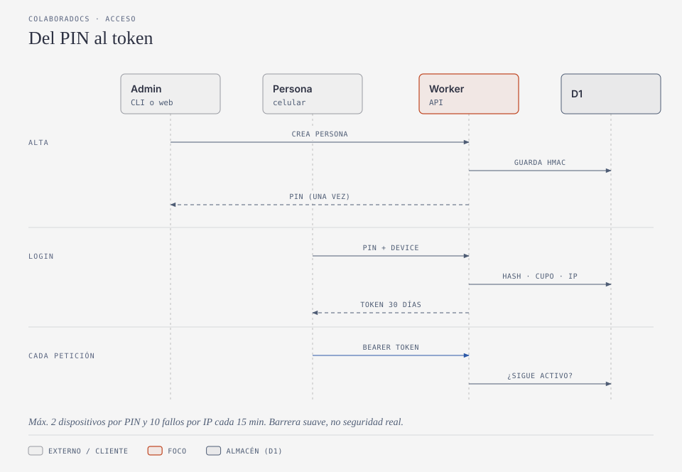

# Colaboradocs

Un espacio de trabajo para que un equipo **revise documentos y presentaciones** antes de darlos por buenos. Acceso con PIN, comentarios por bloque con respuestas, OK por bloque y tareas con fecha. Un solo Worker de Cloudflare (API + D1) sirve la página. Pensado para borradores internos que un grupo revisa desde el celular.

## Qué incluye

| Área | Qué hace | Ruta |
|---|---|---|
| **Documentos** | Texto con secciones que el equipo revisa: comentarios e hilos por bloque, OK por bloque, glosario, fuentes. Se suben (Word, Markdown, JSON) o se editan en la web, con **borrador, publicar y versiones**. | `/d/<id>`, `/d/<id>/editar` |
| **Presentaciones** | Decks como datos (JSON + tema), con editor web, vista previa en vivo, borrador y publicación. Se ven como un HTML autocontenido (teclas, táctil, PDF) y se comentan igual que un documento. | `/p/<id>`, `/p/<id>/editar` |
| **Temas** | Colores claro y oscuro, categorías, tokens y fuentes por organización o evento. Son datos en la base, no código. | (API y CLI) |
| **Tareas** | Algo que una persona hace para una fecha; puede colgar de un documento o bloque. «Mis tareas» y sección Tareas en el editor. | `/tareas` |
| **Accesos** | Una persona = un PIN (máx. 3 dispositivos, configurable por persona). Los admins crean, reemisan, revocan y resetean desde la app. Hay tres niveles: persona, **agente** y admin. | `/accesos` (admin) |
| **Espacio** | Nombre y descripción de la home y cómo se llama el rol de cada persona. | home |
| **Home** | Una tarjeta por documento o presentación, con su actividad. Los documentos van en una sola lista, con su tipo y fecha, y se filtran por tipo o texto; los admins ven al final los archivados. | `/` |



> **Para agentes y contribuciones:** cada módulo tiene su README con mapa, contrato y reglas → [`review-core`](packages/review-core/README.md) · [`review-worker`](packages/review-worker/README.md) · [`review-ui`](packages/review-ui/README.md) · [`doc-import`](packages/doc-import/README.md) · [`web`](apps/web/README.md).

## Estructura

| Carpeta | Qué es |
|---|---|
| `packages/review-core` | TypeScript puro, sin dependencias: tipos del API y del documento, **validación y limpieza de documentos**, ids estables de bloque, hilos, OK y PIN. Con tests. |
| `packages/review-worker` | API en Cloudflare Worker (Hono) + D1: login por PIN, **documentos**, comentarios, OK, accesos. También sirve la página estática. CLI de PIN y de documentos. |
| `packages/review-ui` | Componentes Solid reusables: `ReviewProvider`, `PinGate`, `BlockLayer`, `AccessPanel`, `BottomSheet`, `OverlayProvider`, y el estado (sesión, documentos, accesos). El contenido solo tiene que marcar sus bloques con `data-block-id` (ver `assignBlockIds` en `review-core`). |
| `packages/deck-core`, `deck-render`, `themes` | Presentaciones como datos: esquema, validación y descriptores de campos (`deck-core`), datos → HTML autocontenido (`deck-render`) y el tema neutro (`themes`). Los temas de cada organización son JSON en la base. Ver [`ESQUEMA.md`](packages/deck-core/ESQUEMA.md). |
| `packages/doc-import` | Convierte Word (.docx), Markdown y JSON a un documento válido. Lo usan el CLI y la pantalla de subida (en el navegador). |
| `apps/web` | La página (Vite + Solid): home, documentos y pantallas de administración. **No trae documentos**: los pide a la API. |
| `diagramas/` | Los SVG de este README. Se regeneran con `python3 diagramas/generar.py`. |
| `documents/` | Documentos de ejemplo/origen para importar por CLI. El de ejemplo se versiona; los propios no (están en `.gitignore`). |



## Cómo funciona

Los documentos, presentaciones, temas, comentarios, OK, tareas y personas viven en **D1**. El Worker no guarda archivos y la página tampoco: pide el contenido a la API **después** de ingresar el PIN, así que el texto no es público.



### Documentos

- `/` es la home y `/d/<id>` abre un documento. Con un solo documento, `/` redirige a él.
- Un admin sube documentos desde el menú ⋮ → «Documentos» (Word, Markdown o JSON), con vista previa y avisos de lo que no se pudo conservar, o los escribe en el editor (`/d/<id>/editar`).
- Hay **un borrador por documento**, compartido por los admins y con control de revisión para que nadie pise a otro. Publicar lo convierte en la versión vigente; la anterior pasa a las versiones. «Archivar» oculta un documento sin borrar sus comentarios.



### Presentaciones

Un deck es un JSON (una cuadrícula de hasta 4×4 con bloques) que se dibuja con un tema. El editor (`/p/<id>/editar`) guarda un borrador, muestra la vista previa en vivo y publica; lo publicado se ve en `/p/<id>` como un HTML autocontenido. Sus comentarios y OK usan las mismas tablas que los de un documento (`document_id = 'deck:<id>'`). Esquema completo en [`ESQUEMA.md`](packages/deck-core/ESQUEMA.md).



### Tareas

Una tarea es un título, una persona y una fecha (`AAAA-MM-DD`), y puede colgar de un documento y de un bloque. Cualquiera se las asigna a sí misma; asignar a otra persona es de admins. `/tareas` muestra las de quien entró; `GET /api/tasks?scope=all` (admins) trae todas. `POST /api/tasks/batch` (`{ tasks: [...] }`, hasta 50) crea varias con las mismas reglas: si una falla no se crea ninguna.

## Montar tu propia copia

Necesitas Node 20+ y una cuenta de Cloudflare (el plan gratuito alcanza).

```
npm install
npx wrangler login
npm run setup -w @colaboradocs/review-worker -- mi-revision
```

`setup` crea la base D1, escribe `packages/review-worker/wrangler.jsonc` (no se versiona), aplica migraciones, compila, despliega, sube un `TOKEN_SECRET` nuevo (queda en `packages/review-worker/.prod.vars`) y carga el documento de ejemplo. **Respalda `.prod.vars` fuera del repo:** sin él no se pueden crear PIN válidos (si se pierde: generar otro, `secret put` y `reissue` de cada persona).

Luego:

1. **Tu primer admin** (por CLI; los demás se crean desde la app):
   `npm run pins -w @colaboradocs/review-worker -- add "Tu nombre" --admin --municipality="Tu rol" --remote`
2. Entra a la URL `*.workers.dev` que imprimió el deploy y pega el PIN. Un `workers.dev` nuevo tarda unos minutos en tener certificado TLS.
3. **Sube tus documentos** desde el menú ⋮ → «Documentos». O por CLI: `npm run documents -w @colaboradocs/review-worker -- import documents/mi-doc.json --remote`.
4. **Nombre del espacio y rol** (ver «El espacio»).

Para actualizar la app (no los documentos): `npm run build && npm run deploy -w @colaboradocs/review-worker`. Cambios de esquema: agregar `migrations/000N_*.sql` y `npx wrangler d1 migrations apply <base> --remote` **antes** del deploy.

### Varias instancias con un solo código

Si el mismo código sirve a varios despliegues (cada uno con su cuenta de Cloudflare, su base y su dominio), la configuración de cada uno vive **fuera de este repo**, en una carpeta con su `wrangler.jsonc`, `.prod.vars`, `pins.private*` y `backups/`. Los CLI (`pins`, `documents`, `decks`, `setup`) la usan con `NODE_DIR=<esa carpeta>`, **siempre con `--remote`** (la base local no es de ningún nodo):

```
NODE_DIR=/ruta/al/nodo npm run pins -w @colaboradocs/review-worker -- list --remote
NODE_DIR=/ruta/al/nodo npm run documents -w @colaboradocs/review-worker -- list --remote
```

Con `NODE_DIR` el CLI toma la cuenta de Cloudflare del `wrangler.jsonc` del nodo (sin tener que fijar `CLOUDFLARE_ACCOUNT_ID`). El `wrangler.jsonc` del nodo apunta al código con rutas relativas a su carpeta (`setup` las escribe solo cuando se le pasa `NODE_DIR`); se despliega con `wrangler deploy --config <nodo>/wrangler.jsonc`. Una trampa: `apps/web/public/documentos/` se copia al build y se sirve **sin PIN**, así que cada instancia necesita su propio build (`NODE_DIR=/ruta/al/nodo npm run build -w @colaboradocs/web`, que deja la página en `<nodo>/dist`). Un build hecho para otra publicaría sus archivos. Sin `NODE_DIR`, todo funciona como antes, desde `packages/review-worker`.

## Documentos

Un documento es un JSON (ver `documents/example.json` y los tipos en `packages/review-core/src/document.types.ts`). Puedes escribirlo a mano o generarlo desde un archivo:

- **Word (.docx):** estilos «Título 1» (título), «Título 2» (secciones) y «Título 3» (grupos). Si no hay «Título 2», cada «Título 1» es una sección. Las tablas pasan a un párrafo por fila y las imágenes se quitan.
- **Markdown:** `# Título`, un `## Sección` por sección, `### Grupo`, párrafos, listas, **negrita** y *cursiva*.
- **JSON:** el documento completo, con todo lo avanzado (glosario, fuentes, estados).

La pantalla de subida ofrece dos descargas para quien no tiene su documento en un formato que la página lea: `formato-colaboradocs.md` (guía para adjuntar a una conversación con Claude u otro asistente, con las reglas y el ejemplo) y `ejemplo.json`. Se arman desde `documents/example.json` y `buildFormatGuide` (`doc-import`).

Por CLI: `npm run convert -w @colaboradocs/doc-import -- mi.docx --id mi-doc > documents/mi-doc.json`. Todo lo que se sube se valida y se limpia (solo quedan las etiquetas HTML que entiende la página).

Campos del JSON:

- `id` (obligatorio): va en la URL (`/d/<id>`) y es la clave de sus comentarios. **Cambiarlo empieza de cero** (sin comentarios ni OK) y rompe los enlaces. Solo minúsculas, números y guiones.
- `title`, `version`, `updated`: obligatorios. `description` (tarjeta de la home), `shortName`, `eyebrow` (`{version}` se reemplaza) y `lead`: opcionales.
- `tipo` (`acta`, `iniciativa`, `guia` u `otro`; sin él, `otro`): la home los muestra en una sola lista, con el tipo y la fecha sobre el título de cada tarjeta, y se pueden filtrar por tipo (hoja «Filtros») y buscar por texto. Van las iniciativas primero (por título), luego las actas, guías y otros (el más reciente primero, por `date`). El tipo sale como texto sobre el título. `date` (opcional, `AAAA-MM-DD`): cuándo se elaboró el documento; en un acta, el día de la reunión. Sin ella vale `updated`. `responsable` (una iniciativa) y `participantes` (un acta, nombres separados por coma) son texto libre: salen en la tarjeta de la home y como bloques bajo el título, donde cada persona abre su tarjeta. Se editan en el editor, antes del contenido (el responsable y los participantes se eligen entre las personas del espacio). Los archivados los lista `GET /api/documents?archived=1` (solo admins) y no se abren: se recuperan volviendo a subir el documento.
- `highlightSection`: segundo botón del inicio que salta a una sección (opcional).
- `sources`: lista del pie. `url` vacío = solo texto; si no, tiene que empezar con `https://`, `http://` o `/`.
- `sections[]`: `id`, `num` («1», «2»… o «A» para anexos), `title`, `status` (`listo | borrador | pendiente`), `description` y `html`.
- `html` admite `p, ul, ol, li, strong, em, a, br, h3, h4, h5, dl, dt, dd` (el enlace `a` solo lleva `href`, web, `mailto:` o ruta propia). Convenciones:
  - Un primer párrafo que empieza con **«Para qué sirve»** es una nota: no se comenta.
  - Un `<em>` que empieza con `[` (p. ej. `[2, 3]`) es una cita a `sources`.
  - Un `<h3>` que empieza con «Pendientes» cuenta sus viñetas como pendientes.
  - «sección N» en el texto se enlaza a la sección con `num` N.
- Glosario: una sección con `id: "glosario"` hecha de `<dl><dt>Término</dt><dd>Definición</dd></dl>`, más `glossaryTerms` (cómo aparece el término en el texto, en minúsculas → entrada) para que se enlace.
- Límites: hasta 200 secciones y ~1 MB por documento.
- El texto está en español. Los textos fijos de la interfaz están en los componentes de `apps/web/src` y `packages/review-ui/src`.

## El espacio

Nombre y descripción de la home, y cómo se llama el rol de cada persona (en la base es `municipality`). Se cambian por CLI (la pantalla de edición viene después):

```
npm run documents -w @colaboradocs/review-worker -- space --name "Mi equipo" --role-label "Municipio" --role-format "Representante {value}" [--remote]
```

`--role-format` solo cambia cómo se **muestra** el rol en la lista de accesos; el valor guardado es «La Ceja». Sin configurar: el campo se llama «Rol» y se muestra tal cual.

## Qué va a git y qué no

Un solo repo y un solo código para todos los despliegues. **Lo único que no va a git es la data** de cada uno:

| Va a git | No va a git (está en `.gitignore`) |
|---|---|
| El código, las migraciones, las pruebas | `documents/*` (tus documentos en JSON; `documents/example.json` sí va) |
| `documents/example.json` y la plantilla `wrangler.example.jsonc` | `apps/web/public/documentos/` (los archivos que tus documentos enlazan como fuentes) |
| | `docs/` (planes y notas de tu despliegue) |
| | `packages/review-worker/wrangler.jsonc`, `.dev.vars`, `.prod.vars` (tu configuración y secretos) |
| | `packages/review-worker/backups/` y `pins.private*` (respaldos de la base y PIN en claro) |

Los documentos viven en la base de datos (D1); los JSON de `documents/` solo sirven para importarlos por CLI, y se pueden volver a exportar de la base. Lo que **no** se puede reconstruir desde el repo es la base: respáldala (`wrangler d1 export <base> --remote --output packages/review-worker/backups/…`) y guarda esa carpeta fuera del repo.

## Correr y probar

```
npm install
npm test            # core + worker (corre en workerd real, con D1 local) + web
npm run typecheck
npm run lint
```

Todo en local, sin cuenta de Cloudflare:

```
cp packages/review-worker/wrangler.example.jsonc packages/review-worker/wrangler.jsonc   # una vez; el database_id puede quedar así en local
echo "TOKEN_SECRET=$(openssl rand -hex 32)" > packages/review-worker/.dev.vars   # una vez
cd packages/review-worker && npx wrangler d1 migrations apply doc-review --local   # una vez
npm run pins -- add "Ana" "Luis" --admin      # imprime los PIN (desde packages/review-worker)
npm run documents -- import ../../documents/example.json   # un documento para empezar
cd ../.. && npm run build                     # compila la página a apps/web/dist
npx wrangler dev --ip 0.0.0.0 --port 8800     # (en packages/review-worker) API + página en http://localhost:8800
```

Con recarga en caliente: `npm run dev` levanta los dos (Ctrl+C los cierra) → http://localhost:5180. También puedes correrlos por separado: `npm run dev:api` y `npm run dev:web` (también por IP de la red, para el celular). Si `wrangler dev` corre en otro puerto: `API_ORIGIN=http://localhost:PUERTO npm run dev:web`.

**Cuidado con el `database_id` de tu `wrangler.jsonc` local:** los datos de la base local están atados a ese id (en `.wrangler/state`). Si lo cambias (p. ej. volviendo a copiar `wrangler.example.jsonc`), la base local parecerá vacía y todo dará «no such table». Los datos no se pierden: restaura el id.

## PIN y acceso

- Un PIN por persona, 8 caracteres (`K7Q2-M9XP`). En la base se guarda solo un HMAC con `TOKEN_SECRET`.
- `POST /api/login` canjea PIN + id de dispositivo por un token firmado (30 días). El front lo guarda en localStorage.
- Cada PIN sirve en un máximo de 3 dispositivos (`--max-devices=N` para cambiarlo). Compartir el PIN con otra persona consume un cupo; el cuarto dispositivo recibe `device_limit`.
- Revocar un PIN o resetear sus dispositivos corta el acceso al instante: cada petición verifica en D1.
- Máximo 10 PIN fallidos por IP cada 15 minutos.
- **Barrera suave, no seguridad real.** Alcanza para un documento de revisión interna; no pongas nada sensible.



### Rol «agente»

Para un asistente automático (p. ej. Claude). **No es admin**: puede leer todo, crear y editar tareas (asignarlas a cualquiera, verlas todas, asociarlas a un documento), **guardar borradores** de documentos y presentaciones y **publicar documentos**. Publicar tiene condiciones, y las aplica el Worker: solo si el **último guardado del borrador fue suyo** (si un admin lo tocó después, publica un admin) y **nunca con `force`** (si el documento publicado cambió desde que se creó el borrador, falla con `draft_stale` y decide un admin). Puede reemplazar un documento ya publicado: la versión anterior queda en las versiones, pero los comentarios y OK de los párrafos que cambien dejan de aplicar. No puede publicar presentaciones, descartar borradores, archivar, gestionar accesos, ni cambiar el espacio, los temas o los archivos de un deck. Un admin tampoco puede ascenderlo a admin. Las acciones tienen nombre (`documents:draft`, `documents:publish`, `decks:admin`, `tasks:assign`, `access:admin`…) y cada rol es un conjunto de ellas (`ROLE_PERMISSIONS` en `review-core/src/permissions.utils.ts`); una tabla dice qué permiso exige cada ruta `/admin/*` y lo que no está en la tabla es solo de admins. Lo aplica el Worker, no la interfaz.

Se crea solo por CLI (`--agent` no se combina con `--admin`) y necesita la migración `0009_agent.sql` **antes** del deploy:

```
npm run pins -- add "Claude" --agent --municipality="Agente" --remote
```

### Manual UTCP para agentes

`GET /api/utcp` (público, sin secretos) devuelve un manual [UTCP](https://www.utcp.io) con lo que el agente puede hacer: `login`, `list_people`, `list_tasks`, `create_task`, `create_tasks` (hasta 50 de una vez, todo o nada), `update_task`, `list_documents`, `read_document`, `get_document_draft`, `save_document_draft`, `publish_document` y, para presentaciones, `list_decks`, `read_deck`, `list_themes`, `get_deck_draft` y `save_deck_draft`. Un cliente UTCP lo descubre apuntando a esa URL; llama `login` con el PIN del agente y guarda el token en la variable `COLABORADOCS_TOKEN`, que usan las demás herramientas. Cada herramienta lleva como etiqueta el permiso que exige, y el manual solo anuncia las que tiene el rol agente. Del agente en presentaciones: lee, y guarda el borrador de un deck que **ya existe** (no lo crea, y no publica: el borrador de un deck no registra quién lo guardó ni controla revisiones, así que guardar **reemplaza** el que hubiera). Una tarea puede crearse sin documento y asociarse después con `update_task` (`documentId`, `blockId`). Una prueba (`test/utcp.test.ts`) ejecuta cada herramienta tal como la describe el manual contra el API real, para que no se desincronicen.

Operaciones (con `--remote` actúan sobre producción):

```
npm run pins -- add "Nombre" [--admin] [--max-devices=3]
npm run pins -- reissue "Nombre"        # PIN nuevo + resetea dispositivos
npm run pins -- reset-devices "Nombre"  # cambió de celular
npm run pins -- revoke "Nombre"
npm run pins -- list
```

Los PIN en claro quedan en `packages/review-worker/pins.private.txt` (gitignored). Se mandan por WhatsApp uno a uno.

## Decisiones

- **Un solo Worker** sirve la página y la API: sin CORS, un solo deploy.
- **Ids de bloque = sección + hash del texto.** Si se edita un párrafo, sus comentarios y OK dejan de aplicar (a propósito). Cada comentario guarda un extracto del bloque para reconocer los huérfanos.
- **Borrado suave:** un comentario borrado queda con texto `null` para no romper el hilo.
- **Imports relativos en `packages/*`:** el alias `@/` rompe cuando otro paquete consume el código fuente. En las apps sí se usa `@/`.
- `@cloudflare/vitest-pool-workers` está deprecado; se usa `@cloudflare/vitest-plugin`.

## Hoja de ruta

Qué viene y qué dispara cada paso: [`ROADMAP.md`](ROADMAP.md).

## Licencia

Apache-2.0, ver [`LICENSE`](LICENSE).
